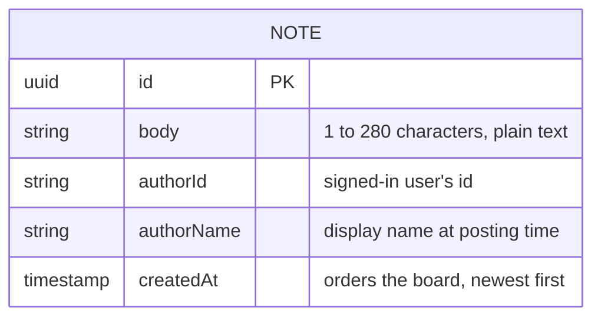

# Domain model

The board holds one kind of record, the note. Notes are written once and never changed or removed.

The author is the signed-in team member who posted the note; people are not stored separately, so the note carries the author's id and name.